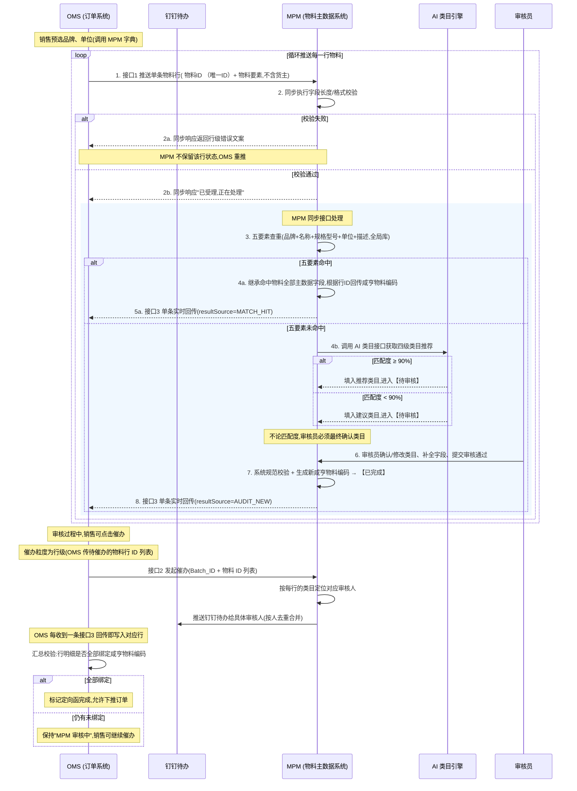

# OMS-MPM 定向采购物料同步及自动化审核需求文档

> **系统链路说明**：本需求中，OMS（订单系统）与 MPM（物料主数据系统）**直接对接**，无中间平台中转。文档中"OMS → MPM"的表述均代表直连调用。
>
> **接口协作核心原则**：OMS 遍历定向函下物料行 → 按行循环调用 MPM 单条推送接口（接口1）→ MPM **同步**完成字段长度/格式校验 →（通过）进入 **MPM 同步接口处理**（5 要素查重 / AI 类目 / 审核员审核）→ 每行回传条件就绪即**单条实时回传** OMS（接口3）→ OMS 自行汇总判定整单是否完成。

---

## 版本记录

| 版本 | 发布日期 | 变更说明 |
|---|---|---|
| **1.0** | 2026-04-24 | 首版定稿。核心设计:<br>① OMS 按行循环调用 MPM **单条推送接口**(接口1);<br>② MPM **同步**做字段长度/格式校验,失败即同步返错、**MPM 不保留**,由 OMS 重推;<br>③ 校验通过后**同步接口处理**进入 **5 要素查重**(品牌+名称+规格型号+单位+描述,不含货主);<br>④ 查重**命中**直接继承主数据、单条实时回传 OMS,不走 AI 类目/人工审核;<br>⑤ 查重**未命中**才调用 AI 类目接口,获取推荐/建议四级类目,**全部由审核员最终确认**;<br>⑥ 审核通过后系统生成新编码,**单条实时回传** OMS(接口3);<br>⑦ **OMS 侧自行汇总**判定整单完成,MPM 不再做整单回传、不再做整单判定;<br>⑧ **催办以行明细为唯一索引**(`Batch_ID + 物料 ID`),`Batch_ID` 不作为催办索引;频率按行级统计(30 分钟 / 每日 6 次);<br>⑨ **OMS 不传货主字段**,MPM 内部货主由 MPM 依据发起人组织/默认规则自动判定;<br>⑩ 原批量推送接口、原整单回传接口、原异步校验失败通知接口(接口4)**整体取消**;<br>⑪ 审核员列表页、详情页等**交互实现不在本版本覆盖**,将在后续独立的交互设计文档中撰写。 |
| **1.1** | 2026-04-27 | 全文订正:① 流程图与全文将"MPM 异步处理(阶段)"统一改为"MPM 同步接口处理";② 命中分支由"自动绑定咸亨物料编码 → 【已完成】"改为"根据物料行 ID 回传咸亨物料编码";相关章节(§3 状态机 / §4 流程图 / §5.2~5.4 / §6 / §9 / §11 接口3)同步对齐。 |
| **1.2** | 2026-04-27 | §11 接口清单新增 **接口 4:【调用】MPM 调用 AI 物料四级分类匹配接口**(`POST /api/workflow/material-category-l4-match/invoke`),含字段映射(MPM 名称→`name`、规格型号+描述→`description`)、请求/响应示例、置信度阈值与异常兜底规则。 |
| **1.3** | 2026-04-27 | §5.3 第三步第 1 点补充审核员交互细节:支持对未匹配/不合适类目**手动选择**,并支持**再次触发接口4** 调用、**弹窗展示** AI 推荐建议与置信度/理由,审核员可一键采用或手动选择(不影响流程图)。 |

---

## 0. 名词解释

| 名词 | 含义 |
|---|---|
| **Batch_ID / 定向函单号** | OMS 定向函的唯一批次编码，贯穿所有行明细。仅用于数据归属与 OMS 侧整单完成汇总；(催办以行明细为粒度,见第 7 节) |
| **物料 ID / 定向函行号** | OMS 行明细的唯一编码，MPM 侧以 `Batch_ID + 物料 ID` 作为行级幂等键、回传绑定键,也是**催办的唯一索引** |
| **MPM 内部货主** | MPM 系统中物料数据归属的内部主体。**OMS 侧不传货主字段**,MPM 依据发起人/审核人所属组织或系统默认规则自动判定(具体规则详见 5.2) |
| **咸亨物料编码** | MPM 系统生成的内部物料唯一编码，用于单条实时回传 OMS 绑定 |
| **四级类目** | MPM 物料分类体系的最细粒度类目，确认后用于读取类目关联的配置字段数据（税收分类、税率、订单执行员等） |
| **五要素** | `品牌 + 名称 + 规格型号 + 单位 + 描述`，作为物料查重的匹配键值，在 MPM 全局物料库做全量检索 |

---

## 1. 业务痛点分析

- **查重颗粒度不足**：传统匹配仅靠名称，易造成"一物多码"，增加库存管理难度。
- **进度不可控**：销售发起申请后无法实时感知 MPM 审核进度，缺乏有效的在线催办机制。
- **数据不一致**：跨系统传输中，单位、品牌等基础维度不统一，导致物料主数据治理混乱。
- **整单回传失真**：原整单回传机制在任一行阻塞时，整单都无法回传，OMS 侧感知迟滞。

---

## 2. 需求概述

本需求旨在通过接口自动化手段，实现 OMS 定向函物料在 MPM 中的**单条推送、同步字段校验、五要素查重、AI 辅助、审核员确认与行级实时回传**。核心原则为：**源头库对齐、查重先行、行级实时、OMS 侧整单汇总**。

通过"查重优先 + AI 辅助类目 + 审核员全量确认"的组合拳，确保物料编码快速、准确地回流至 OMS，支撑销售业务。

---

## 3. 物料行状态机

按**流转路径 × 触发条件 × 两端行状态**的三维结构呈现。每一行物料在 OMS 和 MPM 两个系统中各自维护自己的行级状态,下表描述两者在每个流转事件下的同步关系。

| # | 流转路径 | 触发条件 | OMS 行状态 | MPM 行状态 |
|---|---|---|---|---|
| **1** | **OMS → MPM**<br>(接口1 推送) | 销售提交定向函,OMS 遍历物料行逐条调用接口1 | **已发送,等待同步响应** | **同步校验中**(接收并同步做字段长度/格式校验) |
| **2a** | **MPM → OMS**<br>(接口1 同步响应 - 失败) | 字段长度/格式/字典合法性校验不通过 | **已驳回**,由销售调整字段后**重推该行** | **不保留**(MPM 不落库,不留痕) |
| **2b** | **MPM → OMS**<br>(接口1 同步响应 - 受理) | 字段校验通过,MPM 同步返回 "已受理" | **已受理,等待编码回传** | **同步接口处理中**(涵盖五要素查重、AI 类目匹配、审核员确认审核通过整个内部链路) |
| **3** | **MPM(内部流转)**<br>(同步接口处理节点) | ① 五要素命中,根据物料行 ID 回传咸亨物料编码 或 ② 审核员审核通过并生成新编码 | 继续为"等待编码回传" | **行级已完成**(立即触发接口3 单条回传) |
| **4** | **MPM → OMS**<br>(接口3 单条实时回传) | 物料行进入【已完成】即触发,不等整单 | **已收到编码**,写入订单行明细 | **已回传,行级终态** |
| **5** | **OMS(内部汇总)** | 本 Batch_ID 下所有物料行均已绑定咸亨物料编码 | **定向函已完成**,允许销售下推订单 | —(MPM 侧**不维护整单状态**) |
| **6** | **OMS → MPM**<br>(接口2 催办,独立动作,不改变主状态) | 销售对尚未回传的物料行发起催办(行级索引) | 维持"已受理等待回传",**累计记录该行催办次数** | 维持"同步接口处理中",**按行路由审核人并推送钉钉待办**(不改变行级主状态) |

> **说明**:
> 1. 第 2a 行(同步校验失败)是**纯同步响应**,MPM 不保留任何行级状态;OMS 重新填充后重新发起第 1 步。
> 2. 第 3 行是 MPM 内部的状态迁移,不涉及跨系统调用;为了表达简洁,查重/AI 类目/人工审核三条子路径**合并折叠**为"MPM 同步接口处理"。
> 3. 第 5 行的"定向函已完成"是 **OMS 侧的汇总判定**,由 OMS 根据收齐全部行级编码后自行翻转;MPM 不再做整单完成判定、不再做整单回传。
> 4. 第 6 行催办是**辅助动作**,触发后主状态机保持不变,只是额外触发钉钉推送;催办的详细规则、频率限制、动态路由逻辑见第 7 节。

---

## 4. 业务流程说明 (Mermaid 流程图)



---

## 5. OMS 与 MPM 系统交互全局流程

### 5.1 源头约束（OMS 发起端）

- **标准化录入**：OMS 在填写定向函时，通过 OMS 平台调用 MPM 的基础字典。
  - **品牌**：必须从 MPM 品牌库中选择。
  - **单位**：必须从 MPM 单位库中选择。
- **交互控制**：OMS 端在点击"提交定向函"后，**立即置灰**提交按钮，进入"MPM 审核中"状态，防止重复触发。
- **循环推送**：OMS 遍历定向函下的所有物料行，**对每一行循环调用 MPM 接口1**（单条粒度）。单个定向函预计 200–500 行，OMS 侧应控制并发节奏，避免压垮 MPM。

### 5.2 MPM 接收与同步字段校验（接口1）

- **接口粒度**：MPM 对外开放**单条新增接口**，OMS 按行循环调用。
- **入参**：`Batch_ID` + `物料 ID`（行唯一编码）+ 标准化后的物料要素。**不含货主字段**(货主由 MPM 侧自行判定)。
- **MPM 内部货主判定**:OMS 不传货主。MPM 依据发起人(applicantId)所属组织、审核人归属或系统默认规则自动判定 MPM 内部货主,不阻断接口1 主流程;若需人工指定,由审核员在审核阶段补全。
- **同步校验**：MPM 接收到单行后，**同步执行**字段长度/格式规范校验（如名称/规格型号字符长度、品牌/单位是否在字典内、禁止字符等）。
  - **校验通过**：同步响应"已受理"（`code=200, status=PROCESSING`），随后 MPM 同步接口处理进入五要素查重流程。
  - **校验失败**：**同步响应**直接返回行级错误文案给 OMS（`code=400`，含 `errors[]` 定位到字段）；**MPM 不保留该行任何状态**，失败即纯粹告知，由 OMS 修正后重推该行。
- **行级幂等**：以 `Batch_ID + 物料 ID` 为幂等键；若该行已在处理中，直接拒绝重复推送并返回提示。

### 5.3 数据匹配与分流（接口1 同步响应"已受理"后同步接口处理）

MPM 接口1 同步响应"已受理"后，立即进入同步接口处理。**先执行五要素查重，查重未命中才触发 AI 类目匹配**。

#### 第一步：五要素查重

- 系统按 **5 要素**在 MPM 全局物料库中检索：`【品牌 + 名称 + 规格型号 + 单位 + 描述】`（**不含货主**，全局库全量检索）。
- **冲突降级**：若命中多个（概率极低），取**匹配度最高**（或创建时间最新）的一个。
- **命中**：继承命中物料的咸亨物料编码及全部主数据字段（类目、税收分类、订单执行员等），**无需走 AI 类目/人工审核**，**根据物料行 ID 立即通过接口3 单条实时回传 OMS**。
- **未命中**：数据流转至【待审核】，进入 AI 类目匹配阶段。

#### 第二步：AI 类目匹配（仅未命中路径）

- 系统调用 AI 类目查询接口，获取四级类目推荐值及匹配度。
- **匹配度 ≥ 90%**：系统将推荐类目**预填入**待审核行，等待审核员最终确认。
- **匹配度 < 90%**：系统将建议类目**预填入**待审核行，等待审核员调整/确认。
- **关键规则**：**不论匹配度多少，审核员都必须对类目进行最终确认**，不存在自动采用路径。

#### 第三步：审核员确认与编码生成

- 审核员对处于【待审核】状态的物料行依次完成:
  1. **确认/修改四级类目**：
     - **默认状态**：行内展示接口4 AI 预填的类目（`confidence ≥ 0.90` 为推荐、`< 0.90` 为建议；AI 调用异常时该字段留空）；
     - **手动选择**：针对 **AI 未匹配（类目为空）、AI 建议不合适或审核员认为需要修正** 的物料，审核员**支持手动从四级类目树中选择**任意类目；
     - **再次触发 AI**：审核员可点击行内/详情页的【重新获取 AI 建议】按钮，**再次调用接口4** 动态查询最新类目建议（适用于审核员补全/调整名称、规格型号、描述后想重新获取 AI 推荐的场景）；
     - **弹窗展示**：再次触发后，系统以**弹窗**形式展示 AI 返回的推荐类目、对应**置信度**（`confidence`）及判定理由（`reason`），审核员可在弹窗内**一键采用**或**继续手动选择**；弹窗关闭后行内类目按审核员的最终选择回填。
  2. 基于确认后的类目读取配置字段（税收分类、税率、订单执行员、采购部门、产品经理等）并自动赋值；
  3. 补全其他必填项；
  4. 提交审核通过。
- 系统在审核通过时执行校验：
  - **字段规范校验**：对字段长度、格式等进行校验，任何必填项为空则阻断提交；
  - **字段读取逻辑校验**：读取相关配置字段进行逻辑合规校验。
- 校验通过后，系统生成新的咸亨物料编码，数据进入【已完成】，**立即通过接口3 单条实时回传 OMS**。

> **交互说明**:审核员使用的列表页、详情页、操作按钮、页面跳转等具体交互本版本不覆盖,将在后续独立的交互设计文档中细化。

### 5.4 单条实时回传（接口3）

- **触发时机**（两个节点均触发）：
  1. 五要素命中后，**根据物料行 ID 立即通过接口3 单条回传**（`resultSource=MATCH_HIT`）；
  2. 审核员审核通过，系统生成新编码后 → 该行立即通过接口3 回传（`resultSource=AUDIT_NEW`）。
- **粒度**：每行物料单独回传一次，不等整单、不做批量。
- **内容**：回传字段包含咸亨物料编码、类目、税收分类、订单执行员等全量主数据（详见 11.3）。

### 5.5 OMS 侧整单完成判定

- OMS 每收到一条接口3 回传，即将 `物料 ID → 咸亨物料编码` 写入 OMS 订单行明细。
- OMS 内部**按行事件触发或周期性地**校验当前定向函下所有物料行是否均已绑定咸亨物料编码：
  - **全部绑定**：OMS 自动将定向函状态翻转为"已完成"，允许销售下推订单；
  - **仍有未绑定**：保持"MPM 审核中"状态，销售可发起催办。
- **MPM 不再做整单完成判定**，不再触发整单回传。

---

## 6. MPM 内部执行业务流程逻辑（五步走）

### 第一步：接口1 同步字段校验（Tier 0）

- **同步校验**：接收单行后立即做字段长度/格式/禁止字符/字典合法性校验。
- **成功**：同步响应"已受理"（`code=200, status=PROCESSING`），MPM 同步接口处理继续下一步。
- **失败**：同步响应错误文案（`code=400`，含 `errors[]`），**MPM 不保留任何状态**，OMS 修正后重推该行。

### 第二步：五要素查重（Tier 1）

- **逻辑**：系统以 `【品牌 + 名称 + 规格型号 + 单位 + 描述】` 为键值，在 MPM 全局物料库中检索（**不含货主**）。
- **冲突处理**：若命中 ≥ 2 个编码，系统自动关联**匹配度最高**（或最新使用）的一个。
- **命中**：
  - 继承命中物料的咸亨物料编码及全部主数据字段；
  - **根据物料行 ID 立即通过接口3 单条回传咸亨物料编码**，无需审核员介入、无需走 AI 类目。
- **未命中**：数据流转至【待审核】，进入 AI 类目匹配阶段。

### 第三步：AI 类目匹配（Tier 2，仅未命中路径）

- **AI 预判**：调用 AI 类目查询接口，根据名称、规格型号、描述等信息获取推荐四级类目及匹配度。
- **≥ 90%**：将推荐类目预填入待审核行；
- **< 90%**：将建议类目预填入待审核行；
- **核心规则**：**两种情况下，审核员都必须人工确认类目**，不存在自动采用路径。
- **AI 异常**：AI 接口调用失败时，系统记录日志，类目字段留空，交审核员手动选择，不阻断流程。

### 第四步：人工审核与编码新增（Tier 3）

- **审核对象**:审核员处理所有处于【待审核】状态的物料行(对应为五要素未命中的物料)。
- **处理动作**：审核员确认/修改四级类目 → 系统依据类目读取配置字段并自动赋值 → 审核员补全其他必填字段 → 提交审核通过。
- **系统校验（审核通过时执行）**：
  - 字段规范校验：对字段长度、格式等进行规范校验，必填项缺失则**强行阻断**提交并高亮报错；
  - 字段读取逻辑校验：读取相关配置字段进行逻辑合规校验。
- **终态赋码**：校验通过后生成新的咸亨物料编码，数据进入【已完成】。

> **交互说明**:审核员的列表页、筛选器、批量操作、详情页等具体交互形态本版本不覆盖,将在后续独立的交互设计文档中细化。

> **说明**：本期不实现【自动智能审核】/【自动执行】路径，所有未命中物料均需审核员手动审核通过。

### 第五步：行级实时回传（Tier 4）

- **写入关系表**：每一行进入【已完成】时，立即将 `定向函行号（物料 ID） → 咸亨物料编码` 写入关系表；若该行已有旧值，**直接覆盖**，不做冲突拦截。
- **单条实时回传**：每行进入【已完成】时立即触发接口3 单条回传 OMS，**不等整单**：
  - 命中路径：查重命中后即刻回传；
  - 审核路径：审核通过后即刻回传。
- **MPM 不做整单判定**：整单是否完成由 OMS 根据已收到的单条回传自行统计。

---

## 📝 7. 催办钉钉待办(行级索引)

如果定向函物料没有收到完整物料编码，OMS 可发起催办（接口2）。**催办的唯一索引是物料行(物料 ID),不是 Batch_ID**;Batch_ID 仅作为数据归属上下文传入,便于 MPM 定位行集合。MPM 侧**按待办物料行动态路由**审核人,通过钉钉待办推送强提醒。

- **索引粒度**:**催办以行明细为唯一索引**。OMS 发起催办时需指定要催办的物料行 ID 列表(`omsMaterialIds[]`);MPM 仅对列表中仍处于【待审核】状态的行定位审核人、推送钉钉待办。`Batch_ID` 单独存在不具备催办含义。
- **动态路由逻辑**:MPM 对催办列表中每一行,依据该行的**类目 + 品牌 + 货主 + 标签**查询对应的**订单执行员 / 采购部门 / 产品经理**,把钉钉待办推送给这些**具体人员**(而非固定审核员)。不同物料行的审核人可能不同,钉钉待办按人去重合并发送。
- **频率限制(行级统计)**:
  - 同一物料行(`Batch_ID + 物料 ID`) **30 分钟内不允许重复发起**;
  - 同一物料行每日催办**不超过 6 次**;
  - 超限的行在响应中单独列出并跳过,不影响列表中其他行的催办。
- **钉钉待办正文示例**:
  - **标题**:`【紧急催办】定向采购物料待审核 - [Batch_ID / 物料 ID]`
  - **发起人**:姓名
  - **发布内容**:您有定向函物料待审核处理【定向函单号编码 + 物料 ID】,请尽快处理;
  - **申请时间**:YYYY-MM-DD HH:mm
- **跳转链接**:具体跳转实现形式在交互设计文档中定义。

---

## 8. 数据模型定义

### 8.1 OMS 输入字段 (Request) — 单行粒度

> 说明：接口1 为单条推送，下表对应一行物料的入参。**OMS 不传货主字段**,MPM 内部货主由 MPM 侧依据发起人组织/审核人归属等规则自动判定。

| **字段名称** | **类型** | **必填** | **说明** | **系统校验** |
|---|---|---|---|---|
| **定向函单号** | String | 是 | 批次 ID（Batch_ID），用于 OMS 侧整单汇总;**不作为催办唯一索引** | — |
| **物料 ID** | String | 是 | OMS 行唯一标识，用于单条回传绑定;与 Batch_ID 构成行级幂等键;**催办的唯一索引** | — |
| **物料名称** | String | 是 | 支持中英文数字标点符号；最短 1 字，最长 40 个字；<br>禁止字符：ł、Š、ő、ç、Í、É、Ã、Ž、Ø、º、ñ（间隔符号不计入） | 格式不符合：【请输入中英文数字标点符号；最短1字，最长40个字】<br>含禁止字符：【无法输入系统禁止字符：ł、Š、ő、ç、Í、É、Ã、Ž、Ø、º、ñ】 |
| **规格型号** | String | 是 | 支持中英文（含英文大小写）数字标点符号；最短 1 字，最长 40 个字；<br>禁止字符：ł、Š、ő、ç、Í、É、Ã、Ž、Ø、º、ñ（间隔符号不计入） | 格式不符合：【请输入中英文（含英文大小写）数字符号；最短1字，最长40个字】<br>含禁止字符：【无法输入系统禁止字符：ł、Š、ő、ç、Í、É、Ã、Ž、Ø、º、ñ】 |
| **品牌** | 品牌库 | 是 | 下拉选择，从预设品牌列表单选 | 非预设数据：【请检查品牌信息，核对后重试】 |
| **单位** | 单位库 | 是 | 下拉选择单位，不可更改 | 非预设数据：【请检查基本单位，核对后重试】 |
| **数量** | String | 是 | 起订量 | — |
| **描述** | String | 是 | 多行文本，填写物料详细描述（如性能、参数等）；最长 1000 个字 | 格式不符合：【请输入中英文数字符号；最长1000个字】 |
| **进货单价** | String | 是 | — | — |
| **发起人** | 人员ID | 是 | 创建人 ID;MPM 可据此判定内部货主归属 | — |

### 8.2 MPM 完整字段及处理规则

| **归类模块** | **字段名称** | **字段类型** | **示例值/说明** | **必填** | **填充逻辑** |
|---|---|---|---|---|---|
| **主要信息** | 货主（MPM内部货主） | 下拉选择 | 万聚国际(杭州)供应链有限公司 | 是 | 写死1025组织
| | 是否维保 | 复选框 | 是/否 | 否 | 当货主是 1000 且“维保”字段启用，且当前物料类型是“服务”的时候，利润中心编码传 10002 给到OMS |
| | 数据类型 | 默认展示 | 标品物料 | 否 | — |
| | 标品物料 | 默认展示 | 物料编码 A00000001 | 否 | — |
| | 物料标签 | 默认展示 | 1：定向物料；2：自营物料；3：落地商物料 | 是 | 默认：1（定向物料） |
| | 品牌 | 文本（下拉选择） | 牧高笛/MOBI GARDEN | 否 | 对应 OMS 传值品牌 ID |
| | 名称 | 文本输入 | 气垫 | 是 | 对应 OMS 名称 |
| | 规格型号 | 文本输入 | NX20663016 | 是 | 对应 OMS 型号 |
| | **物料编码** | 文本输入 | AB0506486 | 是 | 五要素（品牌+名称+规格型号+单位+描述）命中取旧值 / 审核通过后新增则生成新值 |
| | **四级类目** | 树形下拉选择 | 充气垫 | 是 | 五要素命中时继承已有物料类目；未命中时 AI 提供推荐（≥90%）/建议（<90%），**全部由审核员最终确认** |
| | 规格 | 文本输入 | — | 否 | — |
| | 基本单位 | 单位选择器 | 个 | 是 | 对应 OMS 单位 ID；转换失败则留空，审核提交时强校验 |
| | 订单执行员 | 人员选择器 | 王梦柯-救援防护采购组 | 是 | 依据类目、品牌、标签、货主查询；
| | 采购部门 | 部门选择器 | 救援防护采购组 | 是 | 依据类目、品牌、标签、货主查询；
| | 项目报价员 | 人员选择器 | 余瑶-18654172066 | 是 | 依据类目、品牌、标签、货主查询 |
| | 产品经理 | 人员选择器 | 余瑶-18654172066 | 是 | 依据类目、品牌、标签、货主查询；
| | **市场价** | 数字输入 | 141.7 | 是 | 固定规则：市场价 = 进货单价 × 1.5 |
| | **商城价** | 数字输入 | 104.85 | 是 | 开启价格计算，依据市场价计算 |
| | 项目调拨参考价 | 数字输入 | — | 否 | — |
| | 对外最高成交价 | 数字输入 | — | 否 | — |
| | 品牌限价最低价 | 数字输入 | — | 否 | — |
| | 品牌限价最高价 | 数字输入 | — | 否 | — |
| | 加价系数(%) | 数字输入 | 1 | 是 | 依据类目、品牌、标签、货主查询 |
| | 成本是否含运费 | 单选按钮 | 不含 | 是 | 默认：不含 |
| | 是否含检测费 | 单选按钮 | 不含检测费 | 是 | 默认：不含检测费 |
| | 起订量 | 数字输入 | — | 是 | 默认：空 |
| | 毛重 | 数字输入 | 1 | 是 | 对应 OMS 数量 |
| | 是否倍数下单 | 单选按钮 | — | 是 | 默认：否 |
| | 是否含安装费 | 单选按钮 | — | 是 | 默认：否 |
| | 物料标签（复选） | 复选框组 | 自营物料 | 是 | — |
| | 物料别名 | 文本输入 | — | 否 | — |
| | **描述** | 长文本输入 | 云游充气床，蓝 | 是 | 对应 OMS 描述 |
| | **内部备注** | 长文本输入 | — | 否 | 写入 OMS 定向函单号，格式：`定向函编码：{定向函单号}`；支持通过内部备注字段搜索定向函单号 |
| **次要信息** | 条形码 | 字符串 | 6926767315833 | 否 | — |
| | 净重 | 数字（kg） | — | 否 | — |
| | 税收分类名称 | 字符串 | 其他橡胶制品 | 是 | 依据四级类目查询赋值 |
| | 税收分类编码 | 字符串 | 19位编码 | 是 | 依据四级类目查询赋值 |
| | 税率 | — | — | 是 | 依据四级类目查询赋值 |
| | 报关关税税率 | 数字（%） | — | 是 | — |
| | 简称 | 字符串 | 橡胶制品 | 是 | 依据四级类目查询赋值 |
| | 物料税率 | 数字 | 0.13 | 是 | 依据税率转化填写 |
| | 物料类型 | 选项 | 货物类 | 是 | 依据四级类目展示 |
| | 商城上下架 | 布尔选项 | 上架 | 是 | 默认：上架 |
| | 旧料码 | 字符串 | — | 否 | — |
| | 厂家订货号 | 输入框 | — | 否 | — |
| | 产品线 | 下拉选择 | — | 否 | — |
| | 长 | 数字（mm） | — | 否 | — |
| | 宽 | 数字（mm） | — | 否 | — |
| | 高 | 数字（mm） | — | 否 | — |
| | 体积 | 数字（mm³） | — | 否 | — |
| | 供应商 | 选择器 | — | 否 | — |
| | 发货日 | 数字（天） | — | 否 | — |
| | 是否已经开票 | 布尔选项 | — | 是 | 默认：否 |
| | 是否对商城隐藏 | 布尔选项 | 否 | 是 | 默认：否 |
| | 是否允许自动开票 | 布尔选项 | 是 | 是 | 默认：是 |
| | 商城可售 | 布尔选项 | 是 | 是 | 默认：是 |
| | 是否物料清洗 | 布尔选项 | 否 | 是 | 默认：否 |
| | 是否停产 | — | — | — | 默认：否 |
| | 是否有效期管理 | — | — | 是 | 依据品牌、类目、标签、货主查询 |
| | 有效期 | — | — | 否 | — |
| | 项目 | 枚举值 | — | 否 | — |
| | 行业类型 | 枚举值 | — | 否 | — |
| | 动销类型 | 枚举值 | — | 否 | — |
| | 推荐标签 | 枚举值 | — | 否 | 依据品牌、类目、标签、货主查询 |
| | 厂控标签 | 枚举值 | — | 否 | 依据品牌、类目、标签、货主查询 |
| **资料附件** | 产品资料 | 文件上传（文档） | product_spec.pdf | 否 | — |
| | 检测报告 | 文件上传（文档） | inspection_report.docx | 否 | — |
| | 质量证明 | 文件上传（文档/图片） | quality_certificate.jpg | 否 | — |
| **图片** | 主图 | 图片上传（多图） | main_blue_sofa.png | 否 | — |
| | 详情图 | 图片上传（多图） | detail_scene_01.jpg | 否 | — |
| **外部链接** | 自动推举 | 开关 | 开启 | 否 | — |
| | 外部链接 | 超链接（文本） | https://item.jd.com/... | 否 | — |
| | 平台类型 | 文本（标签） | 京东 | 否 | — |
| | 店铺类型 | 文本（标签） | 自营 | 否 | — |
| | 计价单位转换 | 文本（比率） | 1.0000 ↔ 1.0000 个 | 否 | — |
| **价格佐证** | 价格 | 数值（货币） | 120 | 否 | — |
| | 价格佐证 | 文件（图片） | BIG_AE1229068_01.jpg | 否 | — |
| **拓展属性** | 等级 | 下拉选择（单选） | 主推 | 否 | 默认：零星 |
| | 属性项（依据四级类目加载） | 文本框 | — | 否 | 必填系统校验，审核人员维护 |
| | 颜色分类（依据四级类目加载） | 文本框 | 蓝 | 否 | 必填系统校验，审核人员维护 |
| | 展开尺寸（依据四级类目加载） | 文本框 | — | 否 | 必填系统校验，审核人员维护 |
| **默认信息** | 是否可销售 | 单选框（布尔） | 是 | 是 | 默认：是 |
| | 可用性检查 | 单选框（布尔） | 是 | 是 | 默认：是 |
| | 是否可采购 | 单选框（布尔） | 是 | 否 | 默认：是 |
| | 是否启用批次管理 | 单选框（布尔） | — | 否 | 默认：否 |
| | 最短剩余货架寿命 | 数字输入 | — | 否 | — |
| | 总货架寿命（天） | 数字输入 | — | 否 | — |
| | 是否启用安全库存 | 单选框（布尔） | — | 否 | — |
| | 最大库存（天） | 数字输入 | — | 否 | — |
| | 最小库存（天） | 数字输入 | — | 否 | — |
| | 是否质检 | 单选框（布尔） | 否 | 否 | — |
| | 创建人 | — | — | 是 | 来源 OMS 发起人 |
| | 创建时间 | — | — | 是 | 入库时间 |
| **分配组织** | **回传绑定关系** | — | — | — | 写入 `定向函行号（物料 ID） → 咸亨物料编码`；已有旧值时直接覆盖；**写入即刻触发接口3 单条实时回传 OMS**，不等整单 |
| | 分配使用 | — | — | — | 所有销售组织、万聚、总部公司：外购标品、成品 |

---

## 9. 核心逻辑规则清单

| **维度** | **规则名称** | **详细说明** |
|---|---|---|
| **唯一性校验** | **五要素查重** | 判定依据：`品牌 + 名称 + 规格型号 + 单位 + 描述`，在 MPM 全局物料库中检索，五项完全一致则视为存量复用。**不含货主**。 |
| **查重先行** | **查重优先、AI 辅助** | 五要素查重先行；命中直接继承已有物料主数据，不走 AI 类目/人工审核；未命中才调 AI 类目并进入人工审核。 |
| **货主来源** | **MPM 侧判定** | **OMS 不传货主字段**。MPM 内部货主由 MPM 依据发起人所属组织或系统默认规则自动判定,必要时由审核员补全。货主**不参与**五要素查重键值。 |
| **冲突处理** | **择优关联逻辑** | 五要素命中 ≥ 2 个编码时，系统自动关联**匹配度最高**（或最新使用）的一个；审核员拥有最终切换权。 |
| **类目确认** | **全量人工确认** | 不论 AI 类目匹配度 ≥90% 或 <90%,审核员都必须对四级类目做最终确认,**不存在自动采用路径**。 |
| **编码生成** | **未命中后审核新增** | 五要素未命中时，必须由审核员审核通过后，系统才允许新增咸亨物料编码。 |
| **命中自动写入** | **无需审核员操作** | 五要素命中时，系统自动继承主数据字段，**根据物料行 ID 通过接口3 单条回传咸亨物料编码**，无需审核员介入。 |
| **编码写入** | **覆盖写入规则** | `定向函行号 → 咸亨物料编码` 写入关系表时，直接覆盖已有旧值，不做冲突拦截。 |
| **回传粒度** | **单条实时回传** | MPM 侧不做整单判定，每行进入【已完成】即立即通过接口3 单条回传 OMS。 |
| **整单完成判定** | **OMS 侧汇总** | 整单完成由 OMS 根据已收到的单条回传自行判定；全部行绑定编码则标记定向函完成，允许下推订单。 |
| **同步校验** | **字段规范同步校验** | 接口1 接收单行后**同步**执行字段长度/格式/禁止字符/字典合法性校验；通过则同步响应"已受理"；失败则同步响应行级错误，**MPM 不保留任何状态**。 |
| **回传失败重试** | **接口3 自动重试** | 接口3 单条回传失败时，MPM 记录日志并自动重试 3 次；仍失败由运维侧介入手动补推(具体方式在交互文档中定义)。 |
| **并发保护** | **行级幂等键** | 以 `Batch_ID + 物料 ID` 为幂等键；若该行已在处理中，MPM 直接拒绝重复推送并返回提示。 |
| **催办索引** | **行级唯一索引** | 催办以 `Batch_ID + 物料 ID` 为唯一索引,**Batch_ID 本身不是催办索引**。OMS 发起催办须指定物料行 ID 列表;MPM 按行定位审核人。 |
| **催办频率** | **行级频率控制** | 同一物料行 **30 分钟内不允许重复催办**;同一物料行每日催办**不超过 6 次**;超限的行在响应中单独提示跳过,不影响其他行的催办。 |
| **催办路由** | **按行动态路由** | 推送对象**按待办物料行动态路由**到订单执行员/采购部门/产品经理,按人去重合并发送;若定位不到审核人则由系统默认审核员兜底。 |

---

## 10. 异常场景处理

1. **同步字段校验失败**：MPM 通过接口1 同步响应返回行级错误文案给 OMS，含 `errors[]` 定位字段；**MPM 不保留**任何状态，由 OMS 修正后重推该行。
2. **AI 类目接口调用失败**：系统记录日志，类目字段留空，数据仍进入【待审核】，审核员手动选择类目，不阻断流程。
3. **必填项缺失**：审核员提交审核通过时系统**强校验**，缺值则报错阻断提交(具体错误展示方式在交互文档中定义)。
4. **单条回传失败**：MPM 记录回传日志，接口3 失败时自动重试 3 次；仍失败则由运维侧介入手动补推。
5. **重复提交同一行**：MPM 以 ` 物料 ID` 为幂等键，直接拒绝重复推送并返回 `409` 提示。
6. **OMS 侧长时间未收齐**：OMS 可对仍未获得编码的物料行发起催办(接口2,传 `omsMaterialIds[]`),频率按行级限制(行级 30 分钟 / 行级每日 6 次)。
7. **催办无法定位审核人**：若某行的订单执行员/采购部门/产品经理字段尚未赋值（例如 AI 类目失败、字段未补全），则以该行对应的系统默认审核员兜底接收钉钉待办。
8. **催办含已完成行**:若 OMS 催办列表中包含已进入【已完成】状态或不存在的行,MPM 在响应中单独列出跳过项,仅对仍处于【待审核】的行发起推送。

---

## 11. 接口清单

MPM 对外暴露**两个接收接口**（接口1 单条推送 + 接口2 催办），对 OMS 发起**一个回调接口**（接口3 单条编码回传），并对外**调用一个 AI 服务接口**（接口4 物料四级分类匹配）。

---

### 接口 1：【接收】OMS 定向物料单行推送接口（单条粒度、同步字段校验）

**描述**：OMS 遍历定向函下的物料行，对每一行循环调用本接口。MPM 同步执行字段长度/格式校验，校验通过后同步响应"已受理"并进入同步接口处理后续流程；校验失败则同步响应行级错误文案，**MPM 不保留任何状态**。

- **请求方式**：`POST`
- **接口路径**：`/api/mpm/external/v1/directional/material/sync-single`
- **幂等键**：`batchId + omsMaterialId`

#### 请求报文（单行粒度）

```json
{
  "batchId": "DX202604240001",
  "omsMaterialId": "LINE_001",
  "applicantId": "U9527",
  "applicantName": "张三",
  "submitTime": "2026-04-24 14:00:00",
  "sourceSystem": "OMS",
  "material": {
    "itemName": "气垫",
    "model": "NX20663016",
    "brandId": "B7788",
    "unitId": "U001",
    "quantity": "100",
    "purchasePrice": "100.00",
    "description": "云游充气床，蓝"
  }
}
```

> 说明:MPM 内部货主由 MPM 侧依据 applicantId 所属组织/系统默认规则自行判定;如需人工指定,由审核员在审核阶段补全。

#### 响应报文

**校验通过（同步"已受理"）**：

```json
{
  "code": 200,
  "message": "接收成功，正在处理",
  "data": {
    "batchId": "DX202604240001",
    "omsMaterialId": "LINE_001",
    "status": "PROCESSING"
  }
}
```

**校验失败（同步返回行级错误，MPM 不保留）**：

```json
{
  "code": 400,
  "message": "字段校验失败",
  "data": {
    "batchId": "DX202604240001",
    "omsMaterialId": "LINE_001",
    "errors": [
      {
        "field": "itemName",
        "errorCode": "FIELD_LENGTH_EXCEED",
        "errorMessage": "物料名称长度超出限制，最短1字，最长40字"
      },
      {
        "field": "description",
        "errorCode": "FIELD_FORBIDDEN_CHAR",
        "errorMessage": "描述含禁止字符：Ž"
      }
    ]
  }
}
```

**行级重复提交（幂等拦截）**：

```json
{
  "code": 409,
  "message": "该行已在处理中，请勿重复提交",
  "data": {
    "batchId": "DX202604240001",
    "omsMaterialId": "LINE_001"
  }
}
```

---

### 接口 2：【接收】OMS 催办指令接口（行级索引）

**描述**:销售在 OMS 对**具体物料行**发起催办,MPM 按行校验频率后,按**待办物料行动态路由**到对应审核人(订单执行员 / 采购部门 / 产品经理),通过钉钉待办推送强提醒。**催办以 `Batch_ID + 物料 ID` 为唯一索引,Batch_ID 单独不构成催办请求**。

- **请求方式**:`POST`
- **接口路径**:`/api/mpm/external/v1/directional/material/urge`
- **索引粒度**:请求必须携带 `omsMaterialIds[]`(一个或多个物料行 ID);`batchId` 仅作为上下文,便于 MPM 定位行集合

#### 请求报文(行级催办,支持单行或多行)

```json
{
  "batchId": "DX202604240001",
  "omsMaterialIds": ["LINE_001", "LINE_003", "LINE_007"],
  "urgeUserId": "U9527",
  "urgeUserName": "张三",
  "urgeTime": "2026-04-24 15:00:00"
}
```

#### 响应报文

**成功(含部分行被频率限制跳过的情况)**:

```json
{
  "code": 200,
  "message": "催办处理完成",
  "data": {
    "notifiedLines": 2,
    "notifiedUsers": 3,
    "skippedLines": [
      {
        "omsMaterialId": "LINE_007",
        "reason": "INTERVAL_LIMIT",
        "message": "该物料行 30 分钟内已催办过"
      }
    ]
  }
}
```

**常见错误**:

- **全部行被限频**:`{"code": 429, "message": "所有物料行均触发催办频率限制"}`(响应 data 中列出每行的限制原因)
- **物料行不存在或已完成**:`{"code": 404, "message": "指定物料行不存在或已处于【已完成】,无需催办"}`
- **请求未指定物料行**:`{"code": 400, "message": "请指定要催办的物料行(omsMaterialIds 不能为空)"}`

---

### 接口 3：【回调】MPM 单条编码回传接口（MPM → OMS，单行粒度、实时触发）

**描述**：每一行物料满足回传条件时（**五要素命中后根据物料行 ID 直接回传** 或 审核通过生成新编码后回传），MPM 立即通过本接口将该行物料的咸亨物料编码及全量主数据单条回传至 OMS。**MPM 不等整单，不做整单判定**；OMS 收齐所有行后自行标记定向函完成。

- **请求方式**：`POST`
- **触发时机**：
  1. 五要素命中后，**根据物料行 ID 立即触发**（`resultSource=MATCH_HIT`）；
  2. 审核员审核通过，生成新编码后立即触发（`resultSource=AUDIT_NEW`）。
- **失败重试**：回传失败自动重试 3 次，仍失败则在审核列表提供"手动补推"按钮。

#### 回传字段说明

| **字段名称** | **示例值/说明** | **必填** |
|---|---|---|
| omsMaterialId | LINE_001（OMS 行唯一标识，用于绑定） | 是 |
| 货主 | 1025 | 是 |
| 是否维保 | 是/否| 否 |
| 品牌 | 牧高笛/MOBI GARDEN | 否 |
| **品牌编码** | 023049（6 位数字） | 是 |
| 计息类型 | JXLX0001：代理品牌；JXLX0002：自主品牌 | — |
| 名称 | 气垫 | 是 |
| 物料标签 | 1：定向物料；2：自营物料；3：落地商物料 | 是 |
| 型号 | NX20663016 | 是 |
| **物料编码** | AB0506486 | 是 |
| 四级类目 | 充气垫 | 是 |
| 四级类目编码 | 02010201 | 是 |
| 规格 | — | 否 |
| 基本单位（单位编码） | z11 | 是 |
| 商品单位名称 | 个 | 是 |
| 订单执行员 | 王梦柯 | 是 |
| 采购部门 | 救援防护采购组 | 是 |
 采购部门编码 | 023 | 是 |
| 项目报价员 | 余瑶-18654172066 | 是 |
| 项目报价员工号 | XHGJ002357 | 是 |
| 产品经理 | 余瑶-18654172066 | 是 |
| 市场价 | 141.7 | 是 |
| 商城价 | 104.85 | 是 |
| 结算价 | 无价格时返回空字符串  | 否 |
| 项目调拨参考价 | 无价格时返回空字符串  | 否 |
| 起订量 |对应OMS数量 | 是 |
| 毛重 | 默认1 | 是 |
| 描述 | 云游充气床，蓝 | 是 |
| 内部备注 | — | 否 |
| 供应商 | — | 否 |
| 税收分类名称 | 其他橡胶制品 | 是 |
| 税收分类编码 | 19位数字编码 | 是 |
| 税率 | 0.13 | 是 |
| 货品标识 | 货主公司下的货品类型 | 是 |

#### 请求报文

```json
{
  "batchId": "DX202604240001",
  "omsMaterialId": "LINE_001",
  "resultSource": "MATCH_HIT",
  "material": {
    "shipOwnerCode": "1025",
    "isWarranty": false,
    "brandName": "牧高笛/MOBI GARDEN",
    "brandCode": "023049",
    "interestType": "JXLX0001",
    "itemName": "气垫",
    "materialLabel": "1",
    "model": "NX20663016",
    "mpmMaterialCode": "AB0506486",
    "categoryLevel4": "充气垫",
    "spec": "",
    "unitCode": "z11",
    "unitName": "个",
    "orderExecutor": "王梦柯",
    "purchaseDept": "救援防护采购组",
    "quoter": "余瑶",
    "quoterEmployeeNo": "XHGJ002357",
    "productManager": "余瑶",
    "marketPrice": 141.7,
    "mallPrice": 104.85,
    "settlementPrice": "",
    "projectTransferPrice": 68.15,
    "minOrderQty": null,
    "grossWeight": 1,
    "description": "云游充气床，蓝",
    "internalRemark": "",
    "supplier": "",
    "taxCategoryName": "其他橡胶制品",
    "taxCategoryCode": "1900000000000000000",
    "taxRate": 0.13,
    "goodsIdentifier": ""
  }
}
```

#### 响应报文（OMS 侧返回）

- **成功**：`{"code": 200, "message": "单条编码已接收"}`
- **OMS 侧动作**：将该行编码写入订单明细；汇总校验本 Batch_ID 下所有行是否全部绑定编码；全部绑定则标记定向函"已完成"，允许下推订单。

---

### 接口 4：【调用】MPM 调用 AI 物料四级分类匹配接口（MPM → AI）

**描述**：五要素查重未命中后，MPM 调用 AI 服务获取物料的四级类目推荐及置信度，作为审核员预填值。**AI 调用失败不阻断主流程**：失败时类目字段留空，数据仍流转至【待审核】，由审核员手动选择。

- **请求方式**：`POST`
- **接口地址**：`http://192.168.21.80:18080/api/workflow/material-category-l4-match/invoke`
- **数据格式**：`application/json`

#### 字段对接说明

> **MPM ↔ AI 字段映射**：MPM 在调用本接口前需将 MPM 内部字段拼装为 AI 入参。
>
> | MPM 内部字段 | AI 接口入参 | 说明 |
> |---|---|---|
> | `名称`（itemName） | `name` | 直接对应「客户物料名称」 |
> | `规格型号`（model） + `描述`（description） | `description` | 拼接后对应「客户物料描述」(拼接规则：`规格型号 + 空格 + 描述`，任一为空时取另一项) |

#### 请求参数（入参）

| 参数名 | 类型 | 必填 | 说明 |
|---|---|---|---|
| `name` | string | 是 | 客户物料名称（对应 MPM 名称字段） |
| `description` | string | 否 | 客户物料描述（对应 MPM 规格型号 + 描述拼接结果） |

#### 请求示例

```json
{
  "name": "雨鞋",
  "description": "详见技术文件"
}
```

#### 响应参数（出参）

| 参数名 | 类型 | 说明 |
|---|---|---|
| `code` | int | 响应码：`0` = 成功 |
| `msg` | string | 响应信息 |
| `traceId` | string | 链路追踪 ID |
| `data` | object | 分类结果详情 |
| `data.id` | string | 四级分类编码（与 MPM 类目编码一致） |
| `data.category_name` | string | 分类名称 |
| `data.confidence` | float | 置信度，取值范围 `0 ~ 1` |
| `data.reason` | string | AI 分类判定理由（用于审核员参考） |

#### 响应示例

```json
{
  "code": 0,
  "data": {
    "category_name": "低筒雨鞋",
    "reason": "商品名称为\"雨鞋\"，与候选1\"低筒雨鞋\"的示例商品词条（如\"低筒雨鞋\"\"雨鞋\"）高度一致。虽然商品描述为\"详见技术文件\"未提供细节，但根据类目定义，'雨鞋'在无明确筒高说明时通常默认指低筒款式，且候选1的适用范围明确包含未特别标注筒高的防水雨鞋类产品。其他候选如中筒、高筒雨鞋需明确筒高描述，一次性鞋套需标明'一次性'，均不满足。因此最可能归属为低筒雨鞋。",
    "confidence": 0.95,
    "id": "09070208"
  },
  "msg": "success",
  "traceId": "caa1d236-22d8-405e-abda-837e3436d2f3"
}
```

#### 状态码说明

| code | 含义 |
|---|---|
| `0` | 接口调用成功 |
| 其他 | 调用失败，详见 `msg`；MPM 记录日志后类目字段留空，不阻断主流程 |

#### MPM 侧使用规则（与 §5.3 / §6 第三步保持一致）

| 置信度区间 | MPM 处理动作 |
|---|---|
| `confidence ≥ 0.90` | 将 `data.id` 与 `data.category_name` 作为**推荐类目**预填入【待审核】行，等待审核员最终确认 |
| `confidence < 0.90` | 将 `data.id` 与 `data.category_name` 作为**建议类目**预填入【待审核】行，等待审核员调整/确认 |
| AI 调用异常（超时/非 0 code/网络失败） | 记录日志，类目字段留空，数据仍进入【待审核】，由审核员手动选择，**不阻断主流程** |

> **关键规则**：不论置信度多少，审核员均必须对四级类目做最终确认，**不存在自动采用路径**（呼应 §9 "类目确认 - 全量人工确认" 规则）。`data.reason` 同步写入 MPM 审核详情页，作为审核员判断依据。

---

